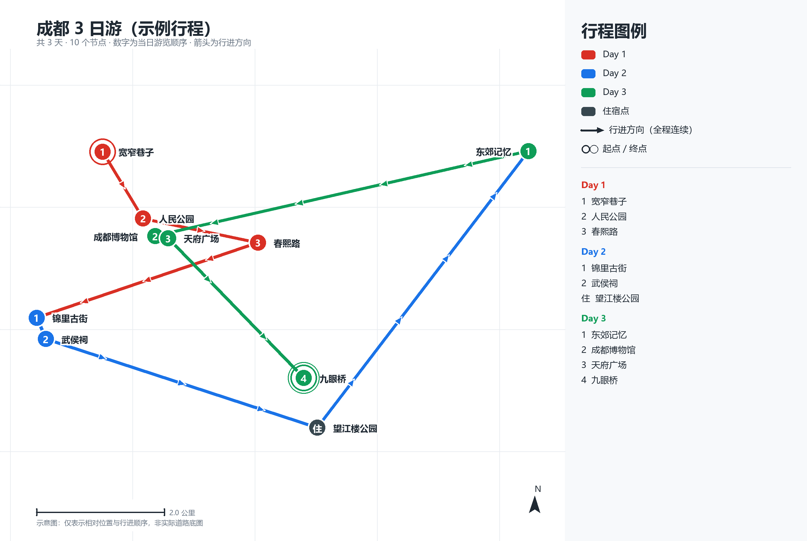

# 百坡山智慧规划旅行家

**Baiposhan Smart Travel Planner** — 把「目的地 + 四个偏好」变成一份能照着走的分日行程、一份能对平的预算表，和一张能直接发朋友圈的矢量路线图。

[](LICENSE)
[](https://www.python.org)
[-brightgreen.svg)](requirements.txt)
[](CHANGELOG.md)
[](https://www.workbuddy.cn)



---

## 目录

- [这是什么](#这是什么)
- [效果预览](#效果预览)
- [核心特性](#核心特性)
- [快速开始](#快速开始)
- [用法](#用法)
- [路线图怎么看](#路线图怎么看)
- [接入百度地图（可选）](#接入百度地图可选)
- [项目结构](#项目结构)
- [重要资源](#重要资源)
- [常见问题](#常见问题)
- [开发与测试](#开发与测试)
- [已知限制](#已知限制)
- [路线图](#路线图)
- [参与贡献](#参与贡献)
- [许可证](#许可证)
- [English](#english)

---

## 这是什么

这是一个 **WorkBuddy 技能（Skill）**，也可以当成一个**独立的 Python 路线图渲染工具**单独使用。

它解决的是旅行规划里两件最烦的事：

1. **行程排不出来**——知道要去哪，但不知道怎么排才不折腾。你说出"轻松还是紧凑、想看自然还是人文、吃得清淡还是重口、预算多少"，它输出每天「游览顺序 / 住宿区位 / 美食 / 当日预算」四栏，顺序是照着走不绕路的。
2. **图画不出来**——想要一张能看的路线图，通常得会设计软件，或者折腾地图 API。它直接给你 **SVG 矢量图**：路线全程连续不断、每段带方向箭头、按天配色、节点带序号、有比例尺和指北针，**并且不需要任何地图账号和密钥**。

**适合谁**：想快速拿到可执行行程的自由行用户；需要给客户出方案的小型旅行工作室；以及想给自己项目加「一键出路线图」能力的开发者。

**不适合谁**：需要真实道路级导航轨迹（请用高德/百度地图 App）；需要实时机票酒店比价（本技能不接入预订系统）。

> 一句话：**它不做"景点罗列"，只做"能照着走的一天"。**

---

## 效果预览

上图由仓库内示例数据 `examples/trip.example.json`（成都 3 日 10 节点）渲染而成，命令见[快速开始](#快速开始)。

| 你想看的 | 文件 |
|---|---|
| 矢量图（可缩放、可编辑） | [`docs/preview.svg`](docs/preview.svg) |
| 位图（社交平台直发） | [`docs/preview.png`](docs/preview.png) |

---

## 核心特性

| 能力 | 说明 |
|---|---|
| **偏好驱动的行程编排** | 节奏（轻松 / 紧凑 / 常规）× 景点喜好（自然风光 / 人文 / 现代都市）× 饮食口味（清淡 / 重口味 / 低脂）× 预算（奢华 / 轻奢 / 节约），四维组合直接决定每天去哪、住哪、吃什么 |
| **预算可对平** | 住宿、餐饮、门票、市内交通四项分项，逐日小计 + 全程合计，**只给区间不给假精确值**（规则见 [`references/budget.md`](references/budget.md)） |
| **SVG 真矢量出图** | 折线、箭头、文字都是矢量元素：放大不糊、可直接打印、能拖进 Figma / Illustrator 继续改 |
| **路线连续 + 方向箭头** | 按「日期升序 → 当日顺序」串成**一条不断开的折线**，跨日转场段同样相连，箭头等距分布并指向下一站，起点单环、终点双环 |
| **零凭据可用** | 核心渲染器不依赖任何地图 AK；有 AK 时才启用百度地图静态图（真实底图，位图） |
| **地图工具链齐全** | AK 自动发现与校验、MCP 配置与探测、批量地理编码、静态图四级降级，全部封装成子命令 |
| **零第三方依赖** | SVG 输出只用标准库；仅 PNG 位图需要 Pillow（可选） |

---

## 快速开始

### 一分钟上手（不需要 WorkBuddy，也不需要任何密钥）

```bash
git clone https://github.com/<your-name>/baiposhan-travel-planner.git
cd baiposhan-travel-planner

python scripts/sketch_map.py --spec examples/trip.example.json --out trip.svg
```

打开 `trip.svg` 就是一张矢量路线图。真实运行输出：

```text
行程：成都 3 日游（示例行程），节点 10 个
[成功] 矢量示意图 → trip.svg（1280×860，13.4 KB，SVG，无 AK）
统计：路径 9 段（跨日转场 2 段）· 箭头 18 个 · 标签 10/10 已放置（越界裁剪 0）· 渲染 371 ms
说明：路线按时间顺序连续绘制并以箭头标示方向；图为矢量示意图，只有相对位置与顺序，不含真实道路底图。
```

需要位图和一份可直接分享的说明页：

```bash
python scripts/sketch_map.py --spec examples/trip.example.json --out trip.svg --png --html --stats
```

产物：`trip.svg`（矢量）、`trip.png`（位图）、`trip.html`（内联矢量的说明页）。

### 方式一：作为 WorkBuddy 技能安装（推荐）

把仓库放进技能目录，客户端启动时自动识别：

```bash
# macOS / Linux
git clone https://github.com/<your-name>/baiposhan-travel-planner.git \
  ~/.workbuddy/skills/baiposhan-travel-planner
```

```powershell
# Windows（默认目录）
git clone https://github.com/<your-name>/baiposhan-travel-planner.git "$env:USERPROFILE\.workbuddy\skills\baiposhan-travel-planner"
```

也可以打包后从客户端导入——左侧栏 **专家·技能·连接器 → 技能 → 添加技能 → 上传技能**：

```bash
python tools/build_package.py       # 产出 dist/baiposhan-travel-planner-v1.5.0.zip
```

装好后直接在对话里说话即可，例如：

> 帮我规划成都 3 天游：轻松节奏，偏人文，口味清淡，轻奢预算

> 从西安出发去杭州 4 天，紧凑节奏想看自然风光，人均 3000 以内

> 没有百度地图 AK，帮我出一张带方向箭头的矢量行程路线图

### 方式二：只当命令行工具用

不需要安装成技能，只要 Python 3.9+：

```bash
python -m pip install pillow        # 仅当你要导出 PNG
python scripts/sketch_map.py --spec 你的行程.json --out 路线图.svg
```

### 方式三：接入百度地图（可选，想要真实底图时）

```bash
python scripts/baidu_map.py ak                          # 看看本机有没有现成 AK
python scripts/baidu_map.py set-ak --ak 你的AK           # 保存到 config.local.json
python scripts/baidu_map.py check                        # 双探测：静态图 + 地理编码
python scripts/baidu_map.py geocode --spec trip.json --out trip-coord.json
python scripts/baidu_map.py staticmap --spec trip-coord.json --out trip.png --html
```

> AK 绑定百度账号且需实名认证，**无法凭空生成**，只能在 [百度地图开放平台](https://lbsyun.baidu.com) 创建。
> 申请、白名单、常见报错见 [`references/baidu-map-setup.md`](references/baidu-map-setup.md)。不配也能用——走 SVG 零凭据路径即可。

---

## 用法

### 输入：行程节点文件

最简形态（完整字段见 [`examples/README.md`](examples/README.md)）：

```json
{
  "title": "成都 3 日游",
  "coordtype": "bd09ll",
  "stops": [
    { "name": "宽窄巷子", "lng": 104.0551, "lat": 30.6699, "day": 1 },
    { "name": "春熙路",   "lng": 104.0805, "lat": 30.6571, "day": 1 },
    { "name": "东郊记忆", "lng": 104.1247, "lat": 30.6700, "day": 2, "lodging": true }
  ]
}
```

要点：**数组书写顺序 = 当日游览顺序**；`day` 决定配色与编号分段；`lodging: true` 表示住宿点。
坐标系支持 `bd09ll`（默认）/ `gcj02ll` / `wgs84ll` / `bd09mc`——渲染器只做相对位置排版，任何坐标系都能画。

### 命令行参数

| 参数 | 说明 |
|---|---|
| `--spec` | **必填**，行程节点 JSON 路径 |
| `--out` | **必填**，输出路径。`.svg` 矢量（推荐，零依赖）／`.png` 位图（需 Pillow） |
| `--png` | `--out` 为 `.svg` 时，额外导出一张同名 PNG |
| `--width` / `--height` | 画布尺寸，默认 `1280×860` |
| `--dpi` | 仅 PNG：超采样倍数，`2` 表示 2x 抗锯齿 |
| `--no-panel` | 不画右侧图例面板（适合窄图或只要路线本身） |
| `--html` | 同时生成内联矢量的 HTML 说明页（含图例与节点清单） |
| `--stats` | 打印统计：路径段数、箭头数、标签放置率、耗时 |

### 三种输出格式怎么选

| 格式 | 适用场景 | 说明 |
|---|---|---|
| `.svg` | 打印、二次设计、网页嵌入、投稿 | 文字仍是文字，可在 Figma / Illustrator / Inkscape 中编辑 |
| `.png` | 微信、小红书、PPT 直接贴图 | 需要 Pillow；默认 2x 抗锯齿 |
| `.html` | 发给朋友看、当作品集附件 | 内联 SVG，缩放与打印都保持清晰，附带分组节点清单 |

---

## 路线图怎么看

| 图面元素 | 含义 |
|---|---|
| 彩色圆点 + 数字 | 景点节点，颜色区分天数，数字是**当日**游览顺序 |
| 深灰大圆 + 「住」 | 住宿点 |
| 连续折线 | 行进路径，段色取出发日颜色；跨日转场段也相连 |
| 白色描边小三角 | 方向箭头，等距分布，指向下一站 |
| 单环 / 双环 | 全程起点 / 全程终点 |
| 右下角 | 比例尺 + 指北针 |
| 右侧面板 | 图例 + 按天分组的节点清单 |

---

## 接入百度地图（可选）

`scripts/baidu_map.py` 提供 7 个子命令，支持「一次配置、后续零参数」：

| 子命令 | 作用 |
|---|---|
| `ak` | 按优先级自动发现本机 AK：`--ak` → 环境变量 → `config.local.json` → `~/.workbuddy/baidu_map.json` → MCP 配置 |
| `set-ak` | 把 AK 落库到技能目录 `config.local.json`（已在 `.gitignore` 中排除） |
| `check` | 静态图 + 地理编码双探测，校验 AK 是否真的可用 |
| `geocode` | 批量把地址解析成坐标，产出可出图的节点文件 |
| `staticmap` | 拼接静态图 URL 并下载，出带真实底图的标注路线 PNG |
| `mcp-config` | 生成/合并百度地图 MCP Server 配置（写入前自动备份） |
| `mcp-check` | 对 MCP 端点做 initialize + tools/list + 实测调用 |

14 个 MCP 工具的参数与坐标系约定见 [`references/mcp-tools.md`](references/mcp-tools.md)。

---

## 项目结构

```text
baiposhan-travel-planner/
├── SKILL.md                     # 技能定义：frontmatter + 六步工作流程
├── README.md                    # 你正在看的这份
├── CHANGELOG.md                 # 版本变更记录
├── CONTRIBUTING.md              # 开发与提交约定
├── LICENSE                      # MIT
├── requirements.txt             # SVG 零依赖，Pillow 可选
├── _icon.png                    # 技能图标
├── assets/                      # 图标多尺寸版本
├── references/                  # 按需加载的参考资料（不占日常上下文）
│   ├── budget.md                #   预算档位基准与折算规则
│   ├── mcp-tools.md             #   百度地图 MCP 工具参数与坐标系约定
│   ├── baidu-map-setup.md       #   AK 申请、白名单、MCP 接入、报错速查
│   └── static-map-spec.md       #   静态图参数、样式格式、降级与验收
├── scripts/
│   ├── sketch_map.py            # 零 AK 矢量路线图渲染（SVG + 可选 PNG）
│   └── baidu_map.py             # AK 校验 / MCP 配置 / 地理编码 / 静态图
├── examples/
│   ├── trip.example.json        # 成都 3 日 10 节点示例
│   └── README.md                # 节点文件字段说明
├── tests/test_render.py         # 冒烟测试（无需网络与 AK）
├── tools/build_package.py       # 打包为可分发 zip
├── docs/                        # 预览图与文档素材
└── .github/workflows/ci.yml     # CI：ubuntu + windows × py3.9/3.12/3.13
```

### 渲染器架构（改代码前请先看）

`scripts/sketch_map.py` 是**一次布局 + 双后端**：

```text
行程 JSON → build_layout()  → 布局数据（点/路径/箭头/标签/图例）
                             ├─→ render_svg()  → .svg
                             └─→ render_png()  → .png（Pillow 可选）
```

投影、取景、路径、箭头、标签避让、图例**只计算一次**，两个后端共用同一份布局数据，因此 SVG 与 PNG 版式必然一致。新增图形请落在布局层，不要绕过它直接写画布坐标。

---

## 重要资源

### 仓库内文档

| 主题 | 位置 |
|---|---|
| 完整技能说明与工作流程 | [`SKILL.md`](SKILL.md) |
| 行程节点文件字段 | [`examples/README.md`](examples/README.md) |
| 预算档位与折算规则 | [`references/budget.md`](references/budget.md) |
| 百度地图 MCP 工具手册 | [`references/mcp-tools.md`](references/mcp-tools.md) |
| AK 申请与排错 | [`references/baidu-map-setup.md`](references/baidu-map-setup.md) |
| 静态图参数与验收标准 | [`references/static-map-spec.md`](references/static-map-spec.md) |
| 版本变更 | [`CHANGELOG.md`](CHANGELOG.md) |
| 二次开发约定 | [`CONTRIBUTING.md`](CONTRIBUTING.md) |

### 外部资源

| 资源 | 链接 |
|---|---|
| WorkBuddy 官网 | <https://www.workbuddy.cn> |
| WorkBuddy 使用文档 | <https://www.workbuddy.cn/docs/workbuddy/Overview> |
| 百度地图开放平台（申请 AK） | <https://lbsyun.baidu.com> |
| SVG 规范（W3C） | <https://www.w3.org/TR/SVG2/> |
| Pillow 文档 | <https://pillow.readthedocs.io> |

---

## 常见问题

**Q：一定要百度地图 AK 吗？**
不需要。核心渲染器不碰任何地图接口，零配置直接出图。AK 只在你想要**真实道路底图**或**批量地址解析**时才需要。

**Q：路线为什么是直线，不是沿着马路？**
这是**示意图**而非导航轨迹：它表达的是「先后顺序 + 相对位置」，图内已标注「非实际道路底图」。要道路级轨迹，走 `staticmap`（真实底图）或直接用地图 App。

**Q：`pip install pillow` 失败还能用吗？**
能。SVG 输出只用 Python 标准库；Pillow 仅服务于 PNG 位图导出，跳过即可。

**Q：标签被省略了？**
画布拥挤时会自动隐藏放不下的节点名（信息仍在右侧图例与 HTML 说明页）。加 `--width 1600 --height 1000` 或去掉 `--no-panel` 改善。

**Q：技能名是中文，为什么 `name` 是英文？**
`name: baiposhan-travel-planner` 是平台要求的 hyphen-case 标识（全局唯一）；`display_name: 百坡山智慧规划旅行家` 才是界面上显示的名字。

**Q：`coordtype` 填错会怎样？**
渲染器只做相对位置排版，画得出来但形状会偏。真实坐标请用 `geocode` 生成，或先 `map_geoconv` 统一到 `bd09ll`。

---

## 开发与测试

```bash
python tests/test_render.py      # 6 项冒烟测试，全部无需网络与 AK
python tools/build_package.py    # 校验 frontmatter 并打包为 zip
```

测试覆盖：frontmatter 完整性、路径连续性（段数 == 节点数 - 1）、相邻段首尾相接、箭头数量、标签放置率、SVG 结构合法性、单节点与重合坐标边界。

约定：

- **标准库优先**，仅 PNG 后端允许依赖 Pillow，不引入其他第三方包。
- 调整绘制逻辑请同时改布局层与两个后端，**不要**绕过 `build_layout()`。
- 提交前至少跑一遍 `tests/test_render.py`；CI 会在 Ubuntu 与 Windows × Python 3.9/3.12/3.13 上复跑。

---

## 已知限制

- 路线为**节点间直线连线**，表示顺序与相对位置，不是道路级导航轨迹。
- 静态图（`staticmap`）受 URL 长度限制，标注点上限 50 个，超出请用 `--split-day` 拆图。
- 景点营业时间、门票价格、餐厅营业状态以实时检索与用户确认为准——**本技能不臆断**。
- 界面与行程文案以中文为主，英文能力限于技能描述与触发词。

---

## 路线图

- [ ] 接入 `map_directions` 的真实道路 polyline，输出「沿路」路线图
- [ ] 多城市 / 跨城长线行程的自动分段出图
- [ ] 导出 PDF 与 2x/3x 高清 PNG 预设
- [ ] 英文行程文案输出（当前仅英文描述与示例）

有想法欢迎开 [Issue](https://github.com/<your-name>/baiposhan-travel-planner/issues) 讨论。

---

## 参与贡献

欢迎 PR。请先读 [`CONTRIBUTING.md`](CONTRIBUTING.md)，重点两条：**不要提交任何 AK / 密钥**（`config.local.json` 已在忽略列表），**改动渲染逻辑必须补测试**。

---

## 许可证

[MIT](LICENSE) © 2026 百坡山

---

## English

**Baiposhan Smart Travel Planner** is a [WorkBuddy](https://www.workbuddy.cn) skill — and a standalone Python renderer — that turns a destination plus four preferences (pace, sight type, taste, budget) into:

- a **day-by-day itinerary** (visit order / lodging area / food / daily budget),
- a **per-person cost breakdown** (lodging, meals, tickets, local transit) with daily subtotals,
- a **continuous, arrow-annotated SVG route map** — vector, printable, editable in Figma or Illustrator, and rendered **without any map API key**.

### Quick start

```bash
git clone https://github.com/<your-name>/baiposhan-travel-planner.git
cd baiposhan-travel-planner
python scripts/sketch_map.py --spec examples/trip.example.json --out trip.svg
```

Requires Python 3.9+. Pillow is optional and only needed for PNG output.

### Install as a skill

```bash
git clone https://github.com/<your-name>/baiposhan-travel-planner.git \
  ~/.workbuddy/skills/baiposhan-travel-planner
```

Or build a distributable zip and import it via **Skills → Add Skill → Upload**:

```bash
python tools/build_package.py
```

### Key links

- Skill definition and workflow: [`SKILL.md`](SKILL.md)
- Input format: [`examples/README.md`](examples/README.md)
- Optional Baidu Maps setup: [`references/baidu-map-setup.md`](references/baidu-map-setup.md)
- Changelog: [`CHANGELOG.md`](CHANGELOG.md) · License: [MIT](LICENSE)

> The route is a schematic polyline (order and relative position), not road-level navigation. Baidu Maps integration is optional and only adds real basemaps and geocoding.
